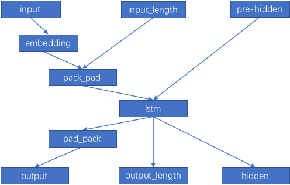
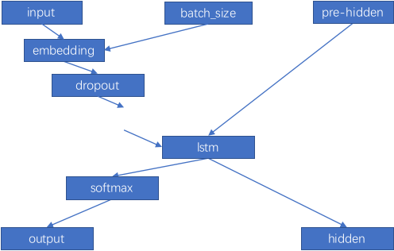
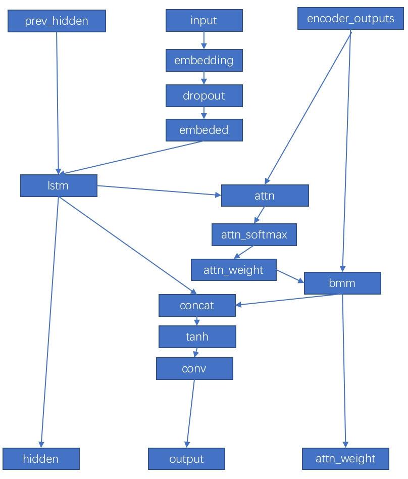
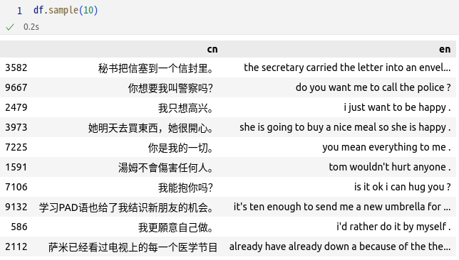

## 一 背景介绍
seq2seq是神经机器翻译的主流框架，如今的商用机器翻译系统大多都基于其构建，在本案例中，我们将使用由NIST提供的中英文本数据训练一个简单的中英翻译系统，在实践中学习seq2seq的具体细节，以及了解机器翻译的基本技术。

从根本上讲，机器翻译需要将输入序列（源语言中的单词）映射到输出序列（目标语言中的单词）。反馈神经网络（RNN）可有效处理此类顺序数据。机器翻译中的一个重要难题是输入和输出序列之间没有一对一的对应关系。即：序列通常具有不同的长度，并且单词对应可以是不平凡的（例如，彼此直接翻译的单词可能不会以相同的顺序出现）。为了解决这个问题，我们将使用一种更灵活的架构，称为seq2seq模型。

seq2seq模型由编码器和解码器两部分组成，它们都是RNN。编码器将源语言中的单词序列作为输入，并输出RNN层的最终隐藏状态。解码器与之类似，除了它还具有一个附加的全连接层（带有softmax激活），用于定义翻译中下一个单词的概率分布。以此方式，解码器本质上用作目标语言的神经语言模型。关键区别在于，解码器将编码器的输出用作其初始隐藏状态，而不是零向量。

## 二 实验目的
* 观测默认程序。
* 划分出一个开发集，在开发集上对于现有超参数(学习率、批处理大小、epoch大小等)进行调优。
* 更改RNN模型为LSTM和BiLSTM(encoder)。
* 完成批处理（batch）、中文分词(jieba)和注意力机制（attention），有时间再尝试预训练过的词向量（如Pretrained Word Vectors），集束搜索（beam search）、和transformer。
* 提交完整的实验报告和测试集结果（相对合理）。

## 三、实验环境
|Model|Version|
| ----------- | ----------- |
| CPU           | Intel(R) Core(TM) i7-10700 CPU @ 2.90GHz|
| GPU           | NVIDIA GeForce RTX 3070|
| NVIDIA-Driver | 515.86.01 |
| NVIDIA-CUDA   | 11.7 |
| OS            | Linux Mint 21.1 Cinnamon|
| python        | 3.10.9 |
| pytorch       | 1.13.1|
| pytorch-cuda  | 11.7|
| pytorch-mutex |1.0|
| torchaudio    | 0.13.1|
| torchvision   | 0.14.1|
| matplotlib    | 3.7.0 |
| numpy         | 1.23.5|
| pandas        | 1.5.3|
| scipy         | 1.10.0|
| jupyter_client| 7.4.9 |
| nltk          | 3.7|
| scikit-learn  | 1.2.1|

## 四 默认程序及结果
### 4.1默认程序观测 
训练的数据集共90000条平行句对，总参与训练68898条，只占数据的76.56%。数据的丢弃率过高。同时，默认迭代50000次，对参与样本的抽取覆盖率只占72.57%。对原始训练样本的利用率不足55.56%。

随机从6个句子的翻译结果上来看，效果非常差。而且句尾有缺失。主要的原因是数据预处理、编码器、解码器和训练方法及参数上欠佳，都有很大的改进空间。
客观上可以引入评价指标BLEU。但因为默认程序没有划分验证集，评价指标BLEU没有横向对比的意义。因此，为了方便本次实验不同模型、参数和方法下的对比，有必要有一些条件进行约定。

### 4.2实验约定
实验在对比模型、参数和方法时，基本参考默认程序的参数和配置。但有的参数不是很合理，特作以下统一和约定。
#### 4.2.1句对的最大长度的约定
故约定平行句对的最大长度为40。此时，取到数据89881，比默认程序多了23.45%的记录。
#### 4.2.2验证集相关约定
从《cn-eng.txt》读取数据后，训练集和验证集按8:2的固定比例划分，固定随机种子为10，在验证集上通过人工评价和评价指标BLEU来对比。
#### 4.2.3人工评价的数据约定
人工评价结合全半角数字、长短句、情感等不同特征，取有代表性的以下几条固定数据进行观测：
* 美國在一八六三年廢除了奴隸制度。
* 关门。
* 我不喝水。
* 请安装linux!
* 为什么我还在这里？
* 這本書有一個弱點作者自己結了婚，但卻建議別人不要結婚，沒有甚麼說服力。
#### 4.2.4评价指标BLEU的约定
取验证集所有数据的BLEU均值作最终评价指标BLEU的值。BLUE的计算使用nltk.translate.bleu_score的sentence_bleu方法。平滑参数smoothing_function= SmoothingFunction().method4。因为nltk计算bleu默认n-gram为4，当匹配度不存在大于等于4的时候，不加这个参数就会计算出一个极小值，无法表示相似度，加上这个平滑参数后，会计算一个相对合理的bleu值。
#### 4.2.5训练次数约定
默认程序未采用批处理，使用50000个epoch,每个epoch随机采样一个平行句对，相当于训练了50000次。而原始数据集的大小为90000，在指定最大平等句对长度为40后，训练集的数据为71903。如果按批大小batch_size为4进行处理，训练8个epoch为143808。为方便后继比较，统一约定在对比模型中训练次数为143808次。
### 4.3默认程序按约定修改后的结果
验证集上得到BLUE为0.042833。

## 五 数据预处理
### 5.1训练集和验证集的划分
按上节中“4.2.2验证集相关约定”，现在来划分训练集和验证集。为避免标准化等清理操作的影响，必须在读取完数据后第一时间划分训练集和验证集，然后再分别进行标准化等操作。
### 5.2批处理，调整不同单词长度的句对
采用批处理后，效果要稍好一些，翻译和关联性有提升。如“我不喝水”，翻译结果从默认程序的“i m t . .”到“i don t drink milk”，应该说进步了一大截。但有明显的”水“到”milk“这样的错误。BLEU也有提升
#### 5.3保留数字和引号
在上面的过程中，很容易发现：引号在参考的人工翻译中，默认程序在数据预处理时有丢失。同时，训练数据中有数字也一同丢失。这肯定对结果的可读性和准确性都有影响。应该把引号和数字都保留下来。

引号和数字的保留通过修改平行句对的标准化处理方法normalize_string即可。实验中保留了全角数字、半角数字和引号“’”:
#### 5.4加入中文分词(jieba)
在世界上众多的语言当中，中文算是比较特殊的一种。许多语言自带分词信息，比如英文，机器学习写作machine learning。machine和learning之间自带一个空格作为分隔。但是中文不是这样，汉字之间没有任何分隔符。意味着程序没有办法直接对文本进行分割。
目前常用的分词算法主要分为两大类，一种是基于词表的规则分词算法。另一种则是在统计分词算法。本实验中使用基于统计分词算法的Jieba主词。	jieba分词模式支持精确模式、全模式、paddle模式和搜索引擎模式。结合前面机器学习和深度学习的实验经验，本实验使用精确模式对中文部分进行分词。

## 六模型更改
### 6.1更改编码器和解码器为LSTM
#### 6.1.1编码器（LSTM）

本实验实现的基于LSTM编码器网络结构如上图。模块接收到输入后，首先对输入作作词嵌入。因为在数据预处理中，进行了批处理填充，所以接着要对填充过的数据进行压缩，才能过LSTM。LSTM输出后，也要进行逆操作，解压返回填充的结果。输入的隐藏状态和单元状态可以当下一时刻的输入隐藏状态。

#### 6.1.2解码器（LSTM）

基于LSTM解码器网络结构如上图。与默认程序中的RNN解码器结果很相似。最大的不同之处在于，过LSTM前加入了一个relu非线性层。

#### 6.1.3结果及模型评价
编码码和解码器使用LSTM+LSTM后，翻译效果有很大提升。如“我不喝水”正确。但有部分还欠佳，如“为什么我还在这里？”中，出现两个still。在验证证集上的BLEU则大幅提高，达到了0.300345。

### 6.2更改编码器模型为双向LSTM（BiLSTM）
本实验实现的基于双向LSTM编码器与LSTM编码器网络结构基本相同。只是在初始化隐藏状态和返回的输出数据有区别。在双向LSTM中，每个时间步的输出由前向LSTM和后向LSTM的隐藏状态组成。此时，双向模式会返回一个outputs张量，它的最后一维是前向和后向LSTM的隐藏状态拼接而成的。我们可以将outputs张量的最后一个维度切分成两半，分别表示前向和后向LSTM的隐藏状态。具体来说，我们可以使用如下代码将outputs切分成前向和后向LSTM的隐藏状态，并将它们相加。

编码码使用双向LSTM后，翻译效果主观上有一定提升。如“为什么我还在这里？”、“请安装linux”、“美國在一八六三年廢除了奴隸制度。”稍好。但在验证证集上的BLEU则有下降。
|方法、模型 | BLEU | 备注 |
|---|---|---|
|RNN+RNN	|0.082472 | jieba,精确模式，保留数字和引号，批处理。|
|LSTM+LSTM	|0.300345 | jieba,精确模式，保留数字和引号，批处理。|
|BiLSTM+LSTM|0.269993 | 编码器为双向LSTM|

### 6.3注意力机制（Attention）
注意力机制在深度学习的实验(https://github.com/yingcongshaw/DL_Novice/tree/main/6.%20%E5%9B%BE%E5%83%8F%E8%87%AA%E7%84%B6%E8%AF%AD%E8%A8%80%E6%8F%8F%E8%BF%B0%E7%94%9F%E6%88%90(COCO2014))中使用过，本次Attention网络和实现参考https://github.com/spro/practical-pytorch/blob/master/seq2seq
-translation/seq2seq-translation-batched.ipynb。网络结构如下：

基本上是本次验证集上最好的效果。但翻译的准确性和精准性还是不够好。长句的翻译还是不行。验证集上BLEU为0.636645。下面测试的结果如果也中包，分数应该是偏低，预计过似合会严重。
测试中采用了集束搜索（beam search）来进一步提高效果。代码使用    https://github.com/OpenNMT/OpenNMT-py/blob/master/onmt/translate/beam.py修改而开。这里就不附代码。
随便取10个句子，效果如下图所示：

	
更详细的测试结果见《7.result.txt》

---
---
# 附：程序文件说明
|文件名	    | 备注  | 
| ----------- | ----------- |
| 1.cn-eng.txt	        | 训练集和验证集数据|
|4.2.1 max_length.ipynb	| 对应报告中的4.2.1小节。句对的最大长度的约定依据。|
|4.3 default.ipynb	    | 对应报告中的4.3小节。默认程序按约定修改后的训练过程和结果|
|5.2 batch.ipynb	    | 对应报告中的5.2小节。批处理，向右填充平行句对。含5.1中训练集和验证集的划分。|
|5.3 normalize.ipynb	| 对应报告中的5.3小节。保留数字和引号的代码。|
|5.4 jieba.ipynb	    | 对应报告中的5.4小节。加入中文分词(jieba)。RNN+RNN的最好结果。|
|6.1 lstm.ipynb	        | 对应报告中的6.1小节。更改编码器和解码器为LSTM。|
|6.2 bi-lstm.ipynb	    | 对应报告中的6.2小节。更改编码器模型为双向LSTM。BiLSTM+LSTM|
|6.3 attention.ipynb    | 对应报告中的6.3小节。注意力机制。BiLSTM+LSTM(Attention)|
|7.result.txt           | 对应报告中的7小节。测试结果|