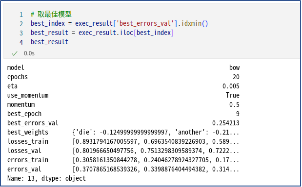
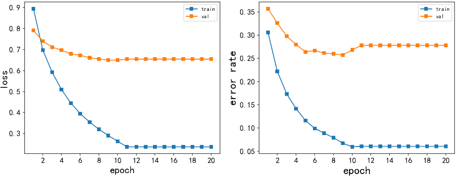
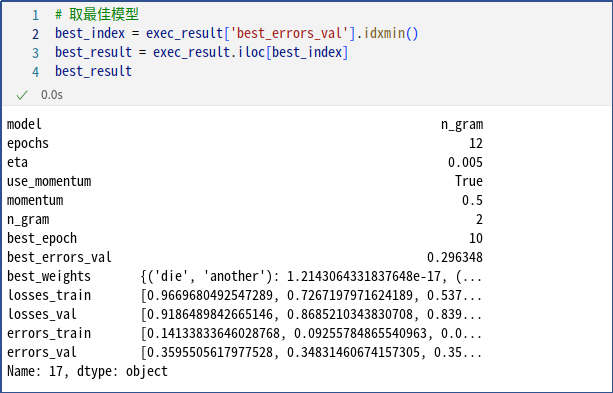
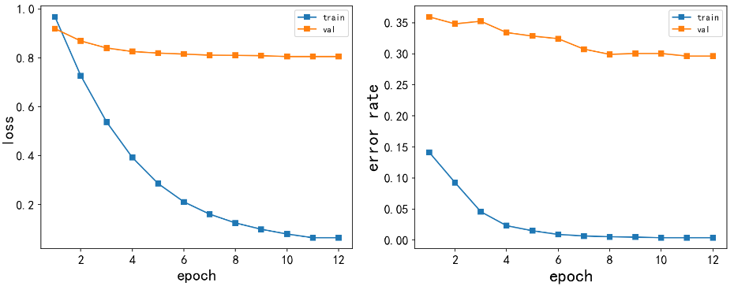
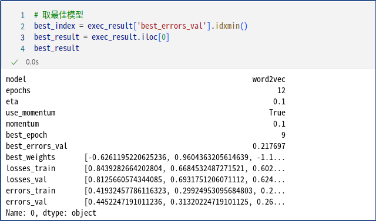
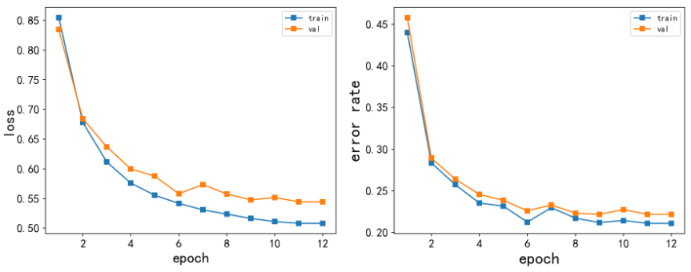

## 一 背景介绍
文本情感分析是对带有情感色彩的主观性文本进行分析、处理、归纳和推理的过程。最初的情感分析源自前人对带有情感色彩的词语的分析，如“美好"是带有褒义色彩的词语，“丑陋”是带有贬义色彩的词语。随着互联网上大量的带有情感色彩的主观性文本的出现，研究者们逐渐从简单的情感词语的分析研究过渡到更为复杂的情感句研究以及情感篇章的研究。
文本情感分析旨在挖掘文本中的主观信息,它是自然语言处理中的经典任务。在本次任务中，我们将在影评文本数据集(Rotten Tomato)上进行情感分析，通过实现课堂讲授的模型方法，深刻体会自然语言处理技术在生活中的应用。

## 二 实验目的
对hinge loss反向传播的理论正确推导,并实现梯度更新函数。
使用BOW、N-Gram、word2vec作为三种文本特征提取方法。
自定义线性分类器，对实验结果充分分析。
使用sklearn的SVM，对比自定义线性分类器。

## 三 实验环境
|Model|Version|
| ----------- | ----------- |
| CPU           | Intel(R) Core(TM) i7-10700 CPU @ 2.90GHz|
| GPU           | NVIDIA GeForce RTX 3070|
| NVIDIA-Driver | 515.86.01 |
| NVIDIA-CUDA   | 11.7 |
| OS            | Linux Mint 21.1 Cinnamon|
| matplotlib| 		3.7.0 | 
| numpy| 		1.23.5| 
| pandas| 		1.5.3| 
| jupyter_client| 	7.4.9 | 
| gensim| 		4.3.0| 
| scikit-learn| 	1.2.1| 
| tqdm| 			4.64.1| 
| wordcloud | 	1.8.2.2  | 

## 四 Hinge loss及梯度下降函数
Hinge loss是一种用于分类问题的损失函数。它的目标是最小化分类器预测值与实际标签之间的差距，同时鼓励分类器将预测值与正确标签之间的差距保持在一个固定的边界以内。

## 五 数据预处理
### 5.1数据集观测和改进
直接打开数据集《data_rt.train》和《data_rt.test》,默认编码字符集下发现有一些字符显示不正常。经查阅，数据集是ISO-8859-1编码。应该是影评用户使用ISO-8859-1中的文字符号（0xA0-0xFF）来代替常规字母所致。如使用è、é、ê来代替e。

### 5.2验证集划分
原训练集《data_rt.train》和测试集《data_rt.test》分别有3554个样本，没有验证集。为方便在训练过程中检验模型的状态，收敛情况，以及调整模型的超参数和结构，考虑划分验证集：从训练集和测试集中各取10%出来，合并构成验证集。

最终训练集、验证集和测试集的样本大小分别为3198、712、3198。

## 六模型和结果
### 6.1 BOW及自定义分类器
BOW全称是Bag-of-words，指的是把一篇文档看作一个袋子，文档中每个单词就是一个”物品“，忽略它们出现的顺序和频率，只保留它们的出现次数，构成一个向量，这个向量就是文档的BOW表示。本次实验将会使用BOW作为特征，自己实现一个简单的线性分类器来作文本情感分析。
#### 6.1.1使用BOW作为特征
在文本情感分析中，BOW可以用于提取文本特征。将每个文本样本表示为一个BOW向量，可以将每个文本样本转化为一个固定长度的向量，方便输入到机器学习算法中。BOW的出现次数还可以作为文本中某些单词的重要性或权重，例如在情感分析中，一些情感相关的词如”happy“、”sad“等可能比一些中性的词如”the“、”is“等更加重要，BOW的出现次数可以反映这种重要性或权重，可以用于分类器的训练。但在本次实验中，向量用独热编码（One-Hot）实现，忽悠BOW的出现多次的单词。使

#### 6.1.2线性分类器和模型
线性分类器可以用来将数据集中的样本分为两类：积极和消极。使用Hinge loss作为损失函数。

学习率采用每10个epoch下降0.5的方式，以便更好更快的找到最佳参数。具体实现见方法learnPredictor()

#### 6.1.3参数对结果的影响
验证集上调参，epochs固定为20个。主要选择学习率(eta in [0.1, 0.05, 0.01, 0.005, 0.001, 0.0005, 0.0001])、是否采用动量(use_momentum in [True, False])，以及采用动量时的加速度(momentum in [0.1, 0.5, 0.9])三个超参数，采用网格搜索.

#### 6.1.4BOW最佳参数及测试结果
通过上节“参数对结果的影响”中分析，我们取验证集上效果最好的参数如下：

在epoch为第10个时，Loss曲线和错误率都表现最好，后续走势也比较合理。模型代入测试集，最终测试集上的错误率为0.277361。与难证集的0.254213差异不大，但比起训练集上的0.060350来说就天差地别，严重过拟合。推测原因可能为二：一是源训练集和源测试集的词意差异较大；二是词袋模型中词表只有训练集，尚未包含验证集和测试集。

在epoch为第10个时，Loss曲线和错误率都表现最好，后续走势也比较合理。模型代入测试集，最终测试集上的错误率为0.277361。与难证集的0.254213差异不大，但比起训练集上的0.060350来说就天差地别，严重过拟合。推测原因可能为二：一是源训练集和源测试集的词意差异较大；二是词袋模型中词表只有训练集，尚未包含验证集和测试集。

### 6.2 n-gram及自定义分类器
#### 6.2.1使用n-gram作为特征
N-Gram提取特征是一种文本特征提取方法，它将文本转化为N个连续的词语组成的序列，然后用这些序列作为特征表示文本。具体地说，N-Gram提取特征的方法将文本中所有的N元组（即连续的N个词语）作为特征，然后将它们表示为一个二元组(key, value)，其中key是N元组，value是该N元组在文本中出现的次数或者出现的二元组（key, 1）数据集中的评论"the history is fascinating ; the action is dazzling . they just don't work in concert ."可以被表示为以下N-Gram特征（这里不考虑去除停用词）

N-Gram提取特征的方法常用于文本分类任务，例如情感分析、垃圾邮件识别等。它可以捕捉到文本中词语之间的局部关系，从而更好地表示文本的语义信息。

#### 6.2.2线性分类器和模型
因为N-Gram和BOW提取的特征向量表示方法和形式是完全一式的，那么对应的线性分类器和模型方法learnPredictor里LOSS的计算、带动量的随机梯度下降优化权重实现是一样的。这是略过（详细实现见上节“6.1.2线性分类器和模型”）。
#### 6.2.3参数对结果的影响
结合上节BOW调参的经验，epochs固定为12个。主要选择滑动窗口(n in [2,3])、学习率(eta in [0.5, 0.1, 0.05, 0.01, 0.005, 0.001, 0.0005, 0.0001])、是否采用动量(use_momentum in [True, False])，以及采用动量时的加速度(momentum in [0.1, 0.5, 0.9])三个超参数，采用网格搜索，滑动窗口n-gram在为3时，整个训练不管其它参数如何设置，都无法收敛。在本例中，想比n-gram为2时，特征空间的维数并没有变大，都是一致的。那么，导致不收敛的最大可能原因就是n=3的n-gram包括很多噪声和不相关的特征，这些特征对模型训练可能没有贡献，反而会干扰模型的学习。

鉴于n-gram在为3时无法收敛，下面只讨论n-gram在为2时的结果。

从epoch上来看，结合BOW观测的结果，N-gram模型中网络搜索实验了12个epoch，基本上比较合理：各个调参组合下都能在10个前找到最好的错误率:

从是否使用动量上来看，使用动量比不用效果要好；使用动量的情况下，momentum值靠近中间值0.5时，Loss下降得更快，更容易找到最佳错误率：

从学习率上来看，取值过低（如0.0001）直接会导致学习无法继续，最合理的学习率在0.005左右。再稍大一点，影响也并不是很大。

#### 6.2.4n-gram最佳参数及测试结果
通过上节“参数对结果的影响”中分析，我们取验证集上效果最好的参数如下：

取20个epoch, 学习率为0.005，使用动量（0.5）时，训练集和验证集上的Loss曲线和错误率走趋如下图所示：

在epoch为第11个时，Loss曲线和错误率都表现最好，后续走势也比较合理。模型代入测试集，最终测试集上的错误率为0.320826。与验证集的0.296348差异较大，与训练集上的0.009550来说更是就天差地别，严重过拟合。推测原因可能为二：一是源训练集和源测试集的词意差异较大；二是词袋模型中词表只有训练集，尚未包含验证集和测试集。

### 6.3 word2vec及自定义分类器
#### 6.3.1使用word2vec作为特征
使用word2vec实现的extractFeatures函数需要将每个句子转化为词向量表示，具体的实现步骤如下：
1．使用预训练的word2vec模型加载词向量
本例中尝试使用预训练的word2vec模型“FastText Word Embeddings”。FastText Word Embeddings是Facebook在Wikipedia上训练的一种预训练词嵌入表示方法，具有多个语言的嵌入表示。FastText的一个优点是它能够生成单词的子单元嵌入，这对于处理词汇丰富的语言（如本例中的英文评论）可能非常有用。下载来源：
https://fasttext.cc/docs/en/english-vectors.html

2．对每个句子进行分词
将句子进行分词，这里没有使用nltk.tokenize 的word_tokenize方法。因为数据集相对规范和简单，就直接用英文空格进行分离。
3．句子的词向量表示
将句子中的每个单词转换为对应的词向量后，如何表示句子向量，有两个方法：
一是将这些词向量拼接在一起作为该文本的特征向量。这样的好处是，可以保留每个单词的信息，缺点是向量长度会变得非常长，且容易过拟合；
二是将这些词向量的平均值作为该文本的特征向量。这样的好处是，向量长度会比较短，且可以降低过拟合的风险，缺点是可能会丢失一些单词的信息。
本次实验使用第二种方法。具体实现如下：

#### 6.3.2线性分类器和模型
线性分类器与前面的BOW类似，但因为词表向量返回时不再是BOW中的字典表，而是直接为列表向量。所以涉及LOSS、梯度和权重的计算更新时，不再调用源方法dotProduct()和increment()。关键步骤和差异见下图：

#### 6.3.3参数对结果的影响
结合上节BOW调参的经验，epochs固定为12个。学习率(eta in [0.5, 0.1, 0.05, 0.01, 0.005, 0.001, 0.0005, 0.0001])、是否采用动量(use_momentum in [True, False])，以及采用动量时的加速度(momentum in [0.1, 0.5, 0.9])三个超参数，采用网格搜索，从epoch上来看，各个参数下，都是在10个epoch内能取到最佳效果，网格搜索中定义epoch为12个，比例合理。

从是否使用动量上来看，使用动量比不用效果要好；使用动量的情况下，momentum值越偏大，效果普通要稳定。但最佳值是在momentum为0.1时取得。

从学习率上来看，取值过低（如0.0001）直接会导致学习无法继续，最合理的学习率在0.1-0.05之间。

6.3.4word2vec最佳参数及测试结果
通过上节“参数对结果的影响”中分析，我们取验证集上效果最好的参数如下：

取12个epoch, 学习率为0.1，使用动量（0.1）时，训练集和验证集上的Loss曲线和错误率走趋如下图所示：

在epoch为第9个时，验证集上的Loss曲线和错误率都表现较好，后续走势也比较合理。模型代入测试集，最终测试集上的错误率为0.236378。对比训练集的0.211069和验证集的0.217697，还算不错。

### 6.4 word2ve+SVM(sklearn)
#### 6.4.1使用word2vec作为特征
沿上面章节“6.3.1使用word2vec作为特征”中方法。
#### 6.4.2SVM(sklearn)
在使用sklearn的SVM(hinge loss)时，使用非常简单。只是在需要在训练前数据做好向量化,然后改写方法learnPredictor().

#### 6.4.3参数对结果的影响
本节实验，使用sklearn的SVM(hinge loss)，在训练模型时需要指定两个参数：C 和惩罚项系数（通常用γ表示）。这两个参数控制着模型的复杂度和泛化能力。

C 参数：C 是一个正则化参数，它控制着分类错误的惩罚程度。C 越小，允许更多的分类错误，但能够得到更广泛的决策边界；C 越大，会强制模型尽可能地正确分类每个数据点，但可能会导致过拟合。C 可以看作是平衡分类的正确率和复杂度之间的权衡。

惩罚项系数（γ）：γ 决定了特征对模型的影响程度，可以看作是正则化的一部分。γ 值越小，对应的高斯核函数宽度越大，决策边界会更加平滑，模型会更具泛化能力；γ 值越大，对应的高斯核函数宽度越小，决策边界会更加复杂，可能会导致过拟合。

网格搜索C和惩罚项系数(c in [0.01, 0.1, 1, 2, 4, 8, 16, 32])和最大跌代次数(epoch in [10,20,50])。针对本次实验的数据集，SVM基本上在20个epoch时已收敛。更多的epoch意思并不大； C和惩罚项系数则在4左右时效果软好。太小会导致模型无法收敛，太大则错误率太高。

#### 6.4.4word2ve+SVM最佳参数及测试结果
在上节中，我们得到word2ve+SVM最佳参数：epochs=20, C=4。把训练得到的模型带入测试集，最终测试集上的错误率为0.229206。