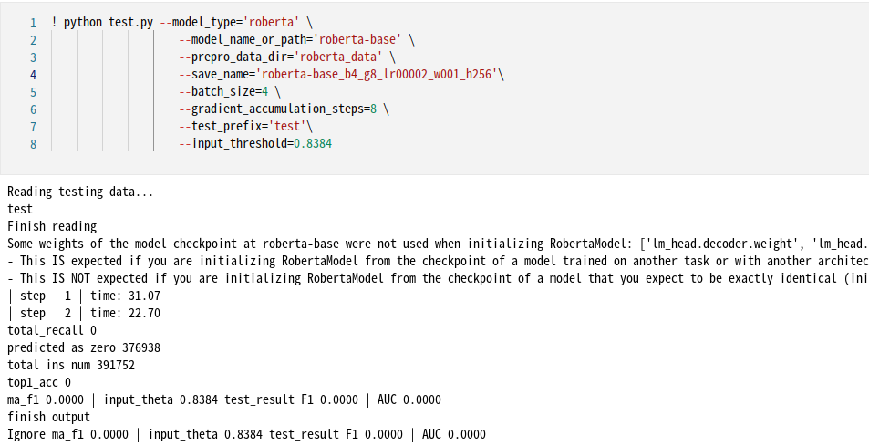
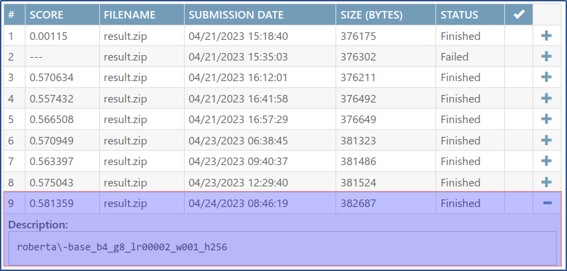

## 一 背景介绍
关系抽取是自然语言处理领域的重要任务，DocRED中大部分关系需要从多个句子中联合抽取，因此需要模型具备较强的获取和综合文章中信息的能力，尤其是抽取跨句关系的能力。
2018年，Google提出了预训练语言模型BERT，该模型在各种NLP任务上都取得了很好的效果。与此同时，它的使用十分方便，可以快速地对于各种NLP任务进行适配。
BERT是目前最具代表性的预训练语言模型，如今预训练语言模型的新方法都是基于BERT进行改进的。研究者如今将各种预训练模型的使用代码整合到了`transformers`这个包当中，使得我们可以很方便快捷地使用各种各样的预训练语言模型。
基于`transformers`的基础后，在本实验中，我们的主要工作就是将数据处理成BERT需要的输入格式，以及在BERT的基础上搭建一个能完成特定任务的模型。最终将调用`transformers`来使用BERT完成文档级别关系抽取的任务。
## 二 实验目的
* 将BERT适配到长文本关系抽取任务DocRED上，从中了解BERT的基本原理和技术细节。
* 回答默认代码文件中标识的问题。
* 训练模型，评测模型在开发集上的结果。
* 完成对于测试数据的评测，并且提交到DocRED的评测系统。
* 使用RoBERTa预训练语言模型完成该实验，对比结果
## 三 实验环境
本次实验主要采用本地环境。实验的环境如下：
|Model|Version|
| ----------- | ----------- |
| CPU           | Intel(R) Core(TM) i7-10700 CPU @ 2.90GHz|
| GPU           | NVIDIA GeForce RTX 3070|
| NVIDIA-Driver | 515.86.01 |
| NVIDIA-CUDA   | 11.7 |
| OS            | Linux Mint 21.1 Cinnamon|
| matplotlib    | 		3.7.0 |
| numpy         | 		1.23.5|
| pandas        | 		1.5.3|
| jupyter_client| 	7.4.9 |
| scikit-learn  | 	1.2.1|
| pytorch       | 		1.13.1|
| pytorch-cuda  | 	11.7 |
| torchaudio    | 	0.13.1|
| torchvision   | 	0.14.1|
| transformers| 	4.24.0|

## 四 默认代码文件中标识的问题
见对应文件。

## 五 数据的预处理
原始数据的预处理，主要是把句子中的词转换成模型需要的输入格式。本次实验中，主要转成两种模型类型：BERT和RoBERTa。两种模型都是分别调用自己的分词器BertTokenizer, RobertaTokenizer把给定的文本分词成一个token序列，然后它会映射这些tokens成tokenizer的词汇表中token所对应的下标，在这个过程中，tokenizer还会增加一些预训练模型输入格式所要求的额外的符号，如，'[CLS]'，'[SEP]'等。经过这个预处理后，将所有处理过的数据保存在bert_token、bert_mask、和bert_starts_ends中，就可以直接地“喂”进我们的预训练模型里面。两种模型类型具体的处理过程有不同：
### 5.1BERT
如果模型类型是BERT，则循环遍历所有的原始数据。对于每一个数据项，获取该数据项中所有句子的词，并使用tokenizer将这些词分割成subwords。然后，将所有subwords拼接成一个长的list：flatten_subwords。这里使用了map函数和列表推导式进行操作。

接下来，将[CLS]和[SEP] token添加到tokens列表的开头和结尾。然后，计算每个subword在tokens中的起始和结束位置，并将它们存储在bert_starts_ends数组中。这里使用了numpy库中的cumsum函数，将前面所有元素的和计算出来，并加上当前元素的值，即可得到当前元素在tokens中的位置。

在得到tokens和bert_starts_ends后，将tokens转换为BERT的输入id，然后用0进行填充，以保证所有的输入都有相同的长度。在tokens列表末尾添加0的个数即为pad_len。然后，使用1和0构造一个mask列表，以指示哪些输入是实际的token，哪些是填充的。最后，将token、mask和bert_starts_ends分别存储在bert_token、bert_mask和bert_starts_ends数组中，以便后续的训练和推理。

本次实验，bert模型使用预训练模型“bert-base-cased”和“bert-large-cased”。

### 5.2RoBERTa
如果模型类型是RoBERTa，使用了一个基本的分词方法，将原始文本按照空格分为单词，然后将单词合并为一个字符串。然后，我们使用RobertaTokenizer的tokenize方法将文本转换为子词列表（subwords）。

接下来，我们通过char2subwords列表来跟踪文本中每个字符对应的子词索引。我们首先将文本中第一个字符所对应的子词的索引设置为0，然后迭代处理每个字符，将其所对应的子词的索引附加到char2subwords列表中。需要注意的是，在处理最后一个单词时，我们需要确保char2subwords的长度与text相同。

有了子词列表和每个字符对应的子词索引，我们可以准备将文本转换为模型输入。首先，我们添加一个特殊的CLS标记到开头，然后在列表的末尾添加一个SEP标记。然后，我们将子词列表转换为整数ID，以便模型可以理解。然后，我们在列表的末尾填充0，得到一个固定长度为长度为max_seq_length的token序列。

我们已经处理了模型输入中的文本，我们需要处理输入中每个单词对应的子词在BERT tokenization后的起始和结束位置。 对于每个单词，我们首先计算其对应的第一个子词的索引。然后，我们确定单词的长度，并在char2subwords列表中找到其最后一个字符所对应的子词的索引。最后，我们在bert_starts_ends数组中为该单词存储起始和结束索引。
本次实验，roberta模型使用预训练模型“roberta-base”和“roberta-large”。

## 六 模型的训练
### 6.1梯度累加对训练和结果的影响
在本次实验中，取Batch_size=8，与Batch_size=4、gradient_accumulation_steps=8比较，把结果按epoch加权平均后，Loss和F1得分差异非常小。在图中已无法观测。重新整理表格如下：

| model	| best epoch| F1| AUC| train times（min）| GPU memory rate | parameter|
|---|---|---|---|---|---|---|
| bert-base-cased	| 184	| 0.574350 	| 0.506681 	| 623	| 94%	| batch_size=8| 
| bert-base-cased	| 184	| 0.568048 	| 0.511480 	| 667	| 62%	| batch_size=4 gradient_accumulation_steps=8| 

不管是否使用梯度累加，都是在184个epoch上取得最好的成绩。但不使用梯度累加的情况下，F1得分要稍好；而使用累加，因为batch_size变小，训练时间有所增加，但显存的占用率否是大幅下降32%。考虑到本实验主要目的不是为了跑分，在训练的同时还可以处理其它事宜，后面的实验都采用梯度累加方式。

### 6.2batch_size对训练和结果的影响
上面的梯度累加中，batch_size和gradient_accumulation_steps分别取了4，8。在显卡支持的前提下，把batch_size和gradient_accumulation_steps分别取到了8和16，整理结果如下：
| model	| best epoch| F1| AUC| train times（min）| GPU memory rate | parameter|
|---|---|---|---|---|---|---|
| bert-base-cased	| 184	| 0.568048 	| 0.511480 	| 667	| 62%|batch_size=4 gradient_accumulation_steps=8 | 
| bert-base-cased	| 184	| 0.558732	| 0.503358 	| 582	| 95%| batch_size=8 gradient_accumulation_steps=16 lr=1e-4 weight_decay=0.01 | 

batch_size增大一倍后，除了训练时间变小外，其它表现都很差。训练时间充分的条件下，batch_size和gradient_accumulation_steps分别取了4、8是个不错的选择。
### 6.3学习率对训练和结果的影响
默认学习率为4e-5，本次实验尝试了增大到1e-4和减小到1e-5 ，并加入了weight_decay=0.01 ，结果整理如下：
| model	| best epoch| F1| AUC| train times（min）| GPU memory rate | parameter|
|---|---|---|---|---|---|---|
|bert-base-cased	|194	|0.562005 	|0.482681	|624	|64%|batch_size=4 gradient_accumulation_steps=8 lr=1e-4 weight_decay=0.01 |
|bert-base-cased	|184	|0.568048 	|0.511480 	|667	|62%|batch_size=4 gradient_accumulation_steps=8 lr=4e-5|
|bert-base-cased	|149	|0.546370 	|0.500714 	|693	|64%|batch_size=4 gradient_accumulation_steps=8 lr=1e-5       weight_decay=0.01 |

可能是引入了权重衰减，显存的占用微微增加。1e-4和1e-5的学习率并没有带来更好的F1得分。可能4e-5是最好的学习，但也有可能调整的步幅要更小一点。

### 6.4预训练模型对训练和结果的影响
本次实验中，默认的模型为bert和bert-base-cased。实验过程中还尝试了bert和bert-large-cased、roberta和roberta-base、roberta和roberta-large。

结果对比整理如下：
| model	| best epoch| F1| AUC| train times（min）| GPU memory rate | parameter|
|---|---|---|---|---|---|---|
|bert-base-cased	|184	|0.5680 	|0.5115 	|667	|62%|batch_size=4 gradient_accumulation_steps=8 lr=4e-5|
|bert-large-cased	|199	|0.5666	    |0.5496	    |546	|77% RTX4090|batch_size=8 model_name_or_path=bert-large-cased gradient_accumulation_steps=16 lr=2e-5 weight_decay=0.01 |
|roberta-base	    |199	|0.5698	    |0.5171	    |625	|63%|batch_size=4 model_type=roberta gradient_accumulation_steps=8 lr=2e-5 weight_decay=0.01 |
|roberta-large	    |199	|0.5678	    |0.5467	    |531	|81% RTX4090|batch_size=8 model_type=roberta model_name_or_path=bert-large-cased gradient_accumulation_steps=16 lr=2e-5 weight_decay=0.01 |

在训练200个epoch下，bert-large-cased、roberta和roberta-base、roberta和roberta-large。都是在最后一个epoch下取到最好得分。我们有理由相信，该模型最没有取到最好的值。bert-large-cased对比bert-base-cased，roberta-large对比roberta-base，并没有明显的得分优势，除了batch_size 除值不同外，其它超参并没有找到最佳。所以，理论上更多参数的large模型并没有和到应该的表现。
### 6.5分类器隐藏层对训练和结果的影响
默认分类器的隐藏层hidden_size 默认为128，我们尝试增大一倍：
| model	| best epoch| F1| AUC| train times（min）| GPU memory rate | parameter|
|---|---|---|---|---|---|---|
|roberta-base	|199	|0.5698	|0.5171	|625	|63%|batch_size=4 gradient_accumulation_steps=8 lr=2e-5 weight_decay=0.01  hidden_size = 128|
|roberta-base	|199	|0.5767	|0.5596	|682	|69%|batch_size=4 gradient_accumulation_steps=8 lr=2e-5 weight_decay=0.01  hidden_size = 256|

隐藏层hidden_size 增大为256后，效果有所提升。但同样也是在最后一个epoch上才得到最好的得分。要有更好的得分，还须再继续训练。
下面的测试，全部会基本于本章节中的roberta-base+hidden_size(256)这个模型。

## 七 评测模型-开发集（dev set）
### 7.1 load_test_data()方法更改
测试模型时，如果要通过随机sample原training set中的一部分数据，观测模型在dev set 下的效果，定义一个要training set取数的比率devset_sample_trainingset_rate，取值为0到1。再更改load_test_data()方法：

### 7.2 10% training data

10% training data时加入了305条记录，最终开发集上的F1结果为0.6768。
### 7.3 50% training data

50% training data时加入了1526条记录，最终开发集上的F1结果为0.8324。

### 7.4 100% training data

100% training data时加入了2035条记录，但没法在本机上正式测试通过。云主机中也不行。试过指定不同的input_threshold，修改不同的batch_size都未果。
### 7.5 小结
本节开发集上的测试结果整理汇总如下：
|trainingset rate	|total data	|Theta	 |F1	|AUC|
|---|---|---|---|---|
|0	    |1000	|0.8384	 |0.5778    |0.5599|
|10%	|1305   |0.9564  |0.6768    |0.6809|
|50%	|2526   |0.9925  |0.8324    |0.8491|
|100%	|4053   |--      |--	    |--|

## 八 DocRED评测系统的测试结果
### 8.1生成测试集

使用上面章节“六模型的训练”中最好的结果：模型roberta-base+hidden_size(256)。先生成开发集。使用此时生成的Theta（0.8384），当做正式测试集的人工指定判定阀值，正式生成测试集结果：

### 8.2提交测试
将上面生成的结果更名为result.json，打包成result.zip，提交到DocRED测试平台https://codalab.lisn.upsaclay.fr/competitions/365中：

本实验，最终使用模型roberta-base+hidden_size(256)，在开发集上的F1结果为 0.5778，在测试平台上的测试结果为0.5814。似合度还不错。

